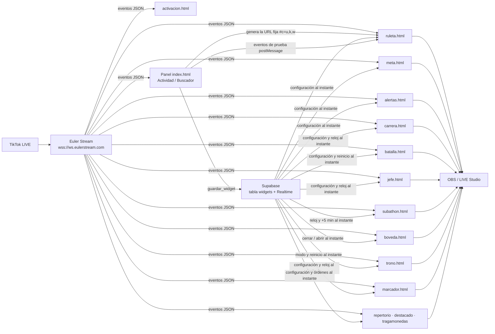
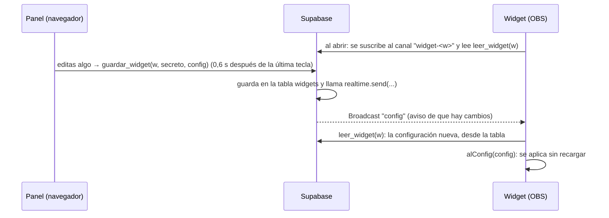

# Live Tools

Herramientas para transmisiones de TikTok LIVE, al estilo de TikFinity, organizadas en el panel así:

- **Juegos** — *Sorteos*: ruleta de regalos (normal y premium) y tragamonedas · *Competencias*: carrera de
  regalos, marcador, batalla de regalos y barra de activación · *Retos del público*: jefe del LIVE, bóveda dorada, subathon y repertorio.
- **Superposiciones** — *Metas* con barra de progreso · *Alertas* animadas · *Reconocimiento*: mensaje VIP
  destacado y trono (el rey del LIVE).
- **Actividad** — eventos del LIVE en vivo y un **catálogo con el ID de cada regalo**.

Los widgets se pegan como **URL** en OBS o en TikTok LIVE Studio y funcionan solos: no hay que dejar
ningún programa abierto en el computador. Todo funciona desde **GitHub Pages** + **Euler Stream**,
con **Supabase** para los cambios en vivo: no hay servidor propio, ni Node.js, ni nada que instalar.

**Cambios en vivo:** la URL de cada widget se copia **una sola vez**. Lo que edites después en el panel
(premios, metas, colores, alertas…) llega solo al widget en OBS en uno o dos segundos, sin recargarlo.

- Panel publicado: `https://ardiladev.github.io/live-tools/`
- Repositorio: `https://github.com/ardiladev/live-tools`
- Documentación técnica completa (Word): [`Documentacion-Live-Tools.docx`](Documentacion-Live-Tools.docx)

> El proyecto antes se llamaba `ruleta-tiktok-live`. Las URLs de widgets copiadas antes del cambio de
> nombre apuntan a la dirección vieja: vuelve a copiarlas desde el panel y pégalas en OBS / LIVE Studio.

---

## Índice

1. [Qué se necesita](#1-qué-se-necesita)
2. [Guía rápida](#2-guía-rápida)
3. [Qué hace cada sección del panel](#3-qué-hace-cada-sección-del-panel)
4. [Cómo funciona por dentro](#4-cómo-funciona-por-dentro)
5. [Estructura de archivos](#5-estructura-de-archivos)
6. [Agregar una función nueva](#6-agregar-una-función-nueva)
7. [Publicación en GitHub Pages](#7-publicación-en-github-pages)
8. [Supabase (cambios en vivo)](#8-supabase-cambios-en-vivo)
9. [Límites y cosas que conviene saber](#9-límites-y-cosas-que-conviene-saber)
10. [Seguridad y privacidad](#10-seguridad-y-privacidad)
11. [Cómo probar los cambios](#11-cómo-probar-los-cambios)
12. [Solución de problemas](#12-solución-de-problemas)

---

## 1. Qué se necesita

| Pieza | Para qué |
|---|---|
| **GitHub Pages** | Publica el panel y los widgets (carpeta `public/`). Es solo una web estática: no ejecuta código en el servidor. |
| **Euler Stream** (plan gratuito) | Lee el LIVE de TikTok y entrega los eventos por WebSocket. Hace falta una **API key**. |
| **Supabase** (plan gratuito) | Guarda la configuración de cada widget y se la avisa al instante (Realtime). Ya está configurado: proyecto `live-tools`. |
| **OBS** o **TikTok LIVE Studio** | Muestra los widgets como fuente de navegador / enlace. |
| Un navegador | Para abrir el panel y configurar. |

| Pregunta | Respuesta |
|---|---|
| ¿Hay que dejar algo abierto? | No: solo la URL en OBS / LIVE Studio. |
| ¿Dónde se configura? | En el panel (`index.html`, publicado en GitHub Pages). |
| ¿Quién se conecta a TikTok? | Cada widget, desde el navegador, vía Euler Stream. |
| ¿Cómo se cambia la configuración? | Se ajusta en el panel y el widget en OBS cambia solo. La URL no cambia. |
| ¿Cuándo hay que volver a copiar la URL? | Solo si cambias la API key de Euler (va dentro de la URL). Si cambias el usuario de TikTok, los widgets se pasan solos a la cuenta nueva. |

---

## 2. Guía rápida

1. Crea una cuenta gratuita en [Euler Stream](https://www.eulerstream.com) y, en el panel de Euler,
   crea una **API key** (sección *API Keys → Create your first key*).
2. Abre el panel y ve a **Ajustes → Cuenta → Conexión**. Escribe tu usuario de TikTok (sin @)
   y pega la API key.
3. Elige un widget, por ejemplo **Juegos → Sorteos → Ruleta de regalos**. Ajusta
   premios y regalo y prueba con el botón **Test**.
4. Pulsa **Copy URL** y, en OBS, agrega una **Fuente de navegador** con esa URL
   (en TikTok LIVE Studio: fuente **Enlace**). Tamaños recomendados:
   ruleta 1080 × 1920 · meta 1200 × 400 · alertas 1280 × 720 · carrera 1920 × 400 · batalla 1600 × 300 · barra de activación 1600 × 400 · jefe 1920 × 300 (arriba de la escena) · subathon 900 × 300 · bóveda 1200 × 400 · trono 700 × 320 · marcador 1920 × 400 ·
   repertorio 600 × 900 · mensaje VIP 900 × 300 · tragamonedas 1200 × 500.
5. Listo. Cuando la cuenta esté en vivo, el widget se conecta solo. Si el LIVE todavía no empieza
   o se corta, reintenta cada minuto.

> Después de copiar la URL, **todo lo que cambies en el panel llega solo al widget**. Debajo de la URL
> verás el estado: “☁ Cambios en vivo: el widget en OBS ya tiene esta configuración”.
> Eso incluye el usuario de TikTok: si lo cambias, los widgets en OBS se conectan solos a la cuenta nueva.
> Solo hay que volver a copiarla si cambias la API key.

---

## 3. Qué hace cada sección del panel

El panel se organiza como TikFinity: **categorías** (íconos de la izquierda) → **grupos
desplegables** (menú) → **vistas** (contenido). Desde el 2026-10-13 se ordena por propósito:
**Juegos** (la persona en vivo y el público juegan), **Superposiciones** (lo que acompaña el LIVE sin ser
un juego), **Actividad** y **Ajustes**. Los ids de las vistas (`#/ruleta`, `#/carrera`…) no cambiaron, así que
las URLs de OBS y lo guardado siguen igual.

| Categoría | Grupo | Vista | Qué hace |
|---|---|---|---|
| Juegos | Sorteos | Ruleta de regalos | Gira y sortea un premio cada vez que llega el regalo configurado. Premios con peso (probabilidad), giros por regalo, tope por combo, ocultar en reposo y sonido. Muestra la **miniatura del regalo** que la activa (del Buscador de regalos) y, en reposo, un **letrero** «Envía … para girar» que sigue a la vista aunque la ruleta se oculte. |
|  |  | Ruleta premium | Una segunda ruleta independiente (mismo `ruleta.html`, otra URL y otra fuente en OBS) para un regalo más caro y premios más grandes. Tiene su propio regalo, premios, opciones y estilo. |
|  |  | Tragamonedas | Como la ruleta, pero con **tres rodillos** (por ejemplo Quién · Qué · Cómo): con el regalo configurado giran y frenan uno tras otro. Textos de cada rodillo, tope por combo, ocultar en reposo y **Probar en OBS**. |
|  | Competencias | Carrera de regalos | Franja horizontal con 1 a 6 integrantes: cada uno tiene su regalo, color y meta; cada regalo suma monedas (precio × cantidad) a su barra. Reloj por rondas en el centro que se **inicia, pausa y reinicia desde el panel** y llega a OBS al instante. Al terminar, muestra quién ganó. |
|  |  | Marcador | Versión sencilla de la carrera: de 1 a 6 integrantes con su regalo, y cada regalo suma a su **puntaje** (sin barras ni metas). Arriba, aparte, el reloj en una píldora pequeña (**Iniciar / Pausar / Reiniciar** en vivo). Color propio opcional por integrante. Por defecto los regalos suman siempre, hasta reiniciar. |
|  |  | Batalla de regalos | Tira y afloja entre dos equipos: cada uno tiene su regalo, monedas por regalo, color y foto opcional. La barra central empieza en 50 % y se corre hacia el equipo que lleva más monedas. Botón **Reiniciar batalla** que pone los puntos en 0 en OBS al instante. **Con cronómetro** (opción en *Personalizar*, encendida por defecto): los regalos solo suman con el reloj en marcha (Iniciar / Pausar / Nueva ronda, duración en segundos) y, al llegar a 0, el equipo con más monedas gana la ronda; arriba se ven las victorias de cada equipo y la racha («🔥 2 seguidas») cuando uno gana 2 o más rondas seguidas. Botón **Reiniciar victorias**. |
|  |  | Barra de activación | Una sola barra repartida en 2, 3 o 4 cuadrantes (selector *Equipos*), uno por equipo; cada equipo tiene nombre, regalo activador, monedas del activador y color. Quien envía el activador de un equipo **se une** a él y desde ahí **cualquier** regalo suyo le suma; si envía el activador de otro, se cambia (lo sumado se queda donde estaba). Los regalos de quien no se ha unido no suman. Cada cuadrante ocupa de la barra el **porcentaje de monedas** de su equipo (al empezar, todos miden lo mismo). Reloj de la ronda (Iniciar / Pausar / Nueva ronda / **Reiniciar ronda**): unirse se puede antes de iniciar, pero las monedas solo suman con el reloj en marcha; al llegar a 0 gana el equipo con más monedas. Debajo de la barra, cada equipo muestra sus monedas, cuántas personas tiene (👥) y quién aportó más (⭐). |
|  | Retos del público | Cola de retos | Fila de retos pendientes para hacerlos con calma cuando llegan muchos regalos seguidos. En OBS se ve el reto de **Ahora** y los siguientes («+N más en espera»). Los retos llegan de la **ruleta** y el **tragamonedas** (casilla *Mandar a la Cola de retos* en su *Personalizar*; en la ruleta se elige qué premios van), de los **retos por regalo** (regalo → reto fijo; un combo es un solo reto «×5») y **a mano**. El panel muestra la cola real: **Hecho**, **Deshacer**, **Vaciar la cola** (pide un segundo clic). Necesita Supabase. |
|  |  | Jefe del LIVE | Reto cooperativo (boss raid): el chat le quita vida a un jefe con likes y regalos antes de que se acabe el tiempo. Nombre, vida total, tiempo límite, texto de victoria y daño por like y por moneda. Raid con **Iniciar / Pausar / Reiniciar** que llegan a OBS al instante. En 0 muestra «Reto desbloqueado» con brillo dorado; si se acaba el tiempo, «Tiempo agotado». |
|  |  | Bóveda dorada | Caja sorpresa: los regalos llenan una barra hacia una meta de monedas; el premio queda oculto hasta llegar. Entonces el candado se abre y aparece el **texto secreto** en letras de oro. Meta, texto secreto, título y pista. **Cerrar y reiniciar** y **Abrir ahora** llegan a OBS al instante. |
|  |  | Subathon | Reloj hacia atrás al que el público le suma tiempo: segundos por cada 100 likes y por cada moneda de regalo, con un **tope**. Tiempo inicial y tope en minutos. **Iniciar / Pausar / +5 min / Reiniciar** llegan a OBS al instante. Pulso dorado al sumarse tiempo y color de alerta con menos de 1 minuto. |
|  |  | Repertorio | Playlist o menú de bailes: lista de canciones, cada una con meta de monedas. Los regalos llenan la **activa**; al llegar a su meta queda «Desbloqueada · Sonando». **Activar**, **Hecha y siguiente**, **Deshacer**, ordenar y **Reiniciar repertorio** en vivo. |
| Superposiciones | Metas | Likes · Seguidores · Compartidos · Monedas | Barra de progreso con meta, título, color propio opcional (si no, el acento del estilo) y acción al alcanzarla (duplicar, volver a empezar o dejarla llena). |
|  | Alertas | Alertas de eventos | Aviso animado por regalos, seguidores y compartidos, en fila, con sonido y mínimo de monedas. |
|  | Reconocimiento | Mensaje VIP destacado | Cuando alguien envía regalos por encima del **umbral**, fija en pantalla su último mensaje del chat por unos segundos (si no escribió, un agradecimiento con su nombre). Los VIP hacen fila. **Quitar el mensaje actual** y **Probar en OBS** en vivo. |
|  |  | Trono | El rey del LIVE: muestra a quien más ha dado, en uno de dos modos: **combo más grande** (de una vez) o **más acumulado en la sesión**. Corona dorada, título («Áurea VIP»), nombre y monedas; transición al cambiar de rey y aviso «Fulano desafía el trono…». Monedas mínimas para reinar y **Reiniciar trono** en vivo. |
| Actividad | En vivo | Eventos en vivo | Conecta el panel al LIVE: contadores (espectadores, likes, seguidores, compartidos, monedas, regalos, mensajes), lista de eventos con filtros y regalos de la sesión. |
|  | Regalos | Buscador de regalos | Catálogo permanente con el ID de cada regalo recibido. Nombres propios, búsqueda, “Copiar ID”, “Usar en ruleta” / “Usar en premium”, agregar a mano, conexión automática y seguimiento de regalos que cambian de código. |
| Ajustes | Cuenta | Conexión con TikTok | Usuario de TikTok y API key de Euler Stream, compartidos por todos los widgets. |

Cada widget tiene una tarjeta con:

- **Copy URL**: copia la URL para OBS (avisa si falta el usuario, la clave o algún dato). Se copia una vez.
- **Estado de los cambios en vivo** (☁): si la configuración ya está en Supabase, si se está enviando o si
  hubo un error (por ejemplo, una ruleta con menos de 2 premios no se envía hasta corregirla).
- **Test**: lanza una prueba en la vista previa.
- **Personalizar**: opciones adicionales y el **estilo visual** de ese widget: 4 estilos predefinidos, cristal
  (obsidiana o perla, opacidad, desenfoque), bordes (grosor, metálico o liso), resplandor, esquinas, colores
  (acento con degradado, texto, bordes, activo, insignias) y tipografía (fuente, espaciado, mayúsculas). La vista
  previa cambia al instante y, con cambios en vivo, OBS también. «Aplicar este estilo a todos los widgets» lo copia
  en las ruletas, las metas, las alertas y en cada juego.
- **Vista previa**: el widget real en modo prueba; **nunca** se conecta al LIVE.

---

## 4. Cómo funciona por dentro

### 4.1 Vista general



- **El panel no es un servidor.** Es una página estática que genera URLs. GitHub Pages solo sirve
  archivos; no ejecuta código.
- **Supabase guarda la configuración** de cada widget. El panel la escribe y el widget la recibe al instante.
  Ver la [sección 8](#8-supabase-cambios-en-vivo).
- **Cada widget se conecta por su cuenta** a Euler Stream con el usuario y la clave que lleva en su URL.
- **El panel también puede conectarse** (sección Actividad) para ver eventos y llenar el catálogo de regalos.
  Esa conexión es independiente de la de los widgets.

### 4.2 La URL del widget y su configuración

La URL lleva los datos en el **fragmento** (lo que está después de `#`), como `#c=…`:
un JSON → UTF-8 → base64 "url-safe" (`codificar` / `decodificar` en `js/comun.js`). El navegador
**nunca envía el fragmento a ningún servidor**: ni GitHub ni nadie ve la clave al cargar la página.

Hay dos formas de URL, y el widget entiende las dos:

| Forma | Qué lleva `#c=` | De dónde sale la configuración |
|---|---|---|
| **Con cambios en vivo** (la que genera el panel) | `u` usuario · `k` API key · `w` identificador del widget | De Supabase, al abrir el widget y cada vez que cambia. Incluye `u`, que gana sobre el de la URL |
| **Completa** (sin Supabase, o URLs viejas) | `u` · `k` · y toda la configuración (tabla de abajo) | De la propia URL; cambiarla = copiar otra URL |

La configuración de cada widget (en Supabase o en la URL completa) usa estas claves cortas:

| Widget | Claves de configuración |
|---|---|
| `ruleta.html` | `g` id del regalo · `r` texto en pantalla · `gpr` giros por regalo · `max` tope por combo · `p` premios `[[texto, peso], …]` · `oc` ocultar sin giros (1/0) · `so` sonido (1/0) · `in` letrero «Envía … para girar» en reposo (1/0) · `img` miniatura del regalo (del Buscador de regalos) |
| `meta.html` | `t` tipo (`likes`/`follows`/`shares`/`monedas`) · `o` objetivo · `ti` título · `col` color · `al` al alcanzar (`duplicar`/`reiniciar`/`nada`) · `s` sonido |
| `alertas.html` | `ev` eventos `{regalo, follow, share}` · `min` monedas mínimas · `d` segundos · `s` sonido |
| `batalla.html` | `a`, `b` equipos `{n nombre, g id del regalo, v monedas por regalo, c color, av foto (URL https), img imagen del regalo}` · `ro` ronda (al cambiar, puntos a 0) · `s` sonido · `cr` con cronómetro (1/0) · `t` reloj `{e, d, fin, r}` · `rv` ronda de victorias (al cambiar, victorias a 0) |
| `activacion.html` | `eq` equipos (2 a 4) `[{n nombre, g id del regalo activador, v monedas del activador, c color, img imagen del regalo}]` · `pr` precios del Buscador `{giftId: monedas}` · `ro` ronda (al cambiar, monedas y equipos a 0) · `s` sonido · `t` reloj `{e, d, fin, r}` |
| `jefe.html` | `ti` nombre del jefe · `hp` vida total · `t` reloj (como en la carrera) · `ro` ronda (al cambiar, vida llena) · `dl` vida por like · `dr` vida por moneda de regalo · `v` monedas de un regalo sin precio · `tv` texto de victoria · `sr` solo con el reloj en marcha · `s` sonido |
| `subathon.html` | `ti` título · `t` reloj base (como en la carrera) · `ro` ronda (al cambiar, se borra lo sumado) · `ex` ms agregados con «+5 min» · `cap` tope en segundos · `sl` segundos por 100 likes · `sd` segundos por moneda · `v` monedas de un regalo sin precio · `s` sonido |
| `boveda.html` | `ti` título · `pi` pista (se ve con la bóveda cerrada) · `sec` texto secreto · `o` meta en monedas · `v` monedas de un regalo sin precio · `ro` ronda (al cambiar, se cierra y vuelve a 0) · `ab` 1 = abrir ahora · `s` sonido |
| `trono.html` | `ti` título · `m` modo (`combo`/`total`) · `min` monedas mínimas para reinar · `v` monedas de un regalo sin precio · `ro` ronda (al cambiar, trono libre) · `s` sonido |
| `marcador.html` | `ti` título junto al reloj · `j` integrantes `[{i id, n nombre, c color (vacío = acento del estilo), g id del regalo, gn nombre del regalo, v monedas por regalo, img imagen}]` · `t` reloj (como en la carrera) · `ro` ronda (al cambiar, puntos a 0) · `sr` solo con el reloj en marcha (por defecto 0) · `s` sonido |
| `cola.html` | `ti` título · `mx` retos a la vista (3 a 8) · `us` mostrar quién lo pidió · `oc` ocultar sin retos · `s` sonido · `rg` retos por regalo `[{g id del regalo, gn nombre, t reto, img imagen}]` · `cl` id de la cola (el mismo `w`; lo usa la vista previa). La ruleta lleva además `rc` (id de la cola, vacío = no manda), `rcn` (origen), `uc` (1 = un solo giro por combo: el premio sale «×N» en pantalla y en la cola) y cada premio un tercer valor `0` si no va a la cola; el tragamonedas lleva `rc`. |
| `repertorio.html` | `ti` título · `c` canciones `[{i id, n nombre, m meta}]` · `a` id de la activa · `h` ids hechas · `mx` cuántas se ven (3 a 5) · `v` monedas de un regalo sin precio · `ro` ronda (al cambiar, todo a 0) · `s` sonido |
| `destacado.html` | `um` umbral VIP en monedas · `d` segundos en pantalla · `ti` etiqueta · `tx` agradecimiento si no escribió · `v` monedas de un regalo sin precio · `lp` quitar el mensaje actual · `pr` probar en OBS · `s` sonido |
| `tragamonedas.html` | `g` id del regalo · `r` texto en pantalla · `rd` rodillos `[{t título, i [textos]}]` (3) · `max` tope por combo · `oc` ocultar sin giros · `pr` probar en OBS · `s` sonido |
| `carrera.html` | `ti` título · `j` integrantes `[{i id, n nombre, c color, g id del regalo, gn nombre del regalo, v monedas por regalo, m meta, img imagen}]` · `t` reloj `{e listo/corre/pausa, d segundos, fin hora de término, r ms restantes}` · `ro` ronda (al cambiar, puntos a 0) · `sr` solo cuenta con el reloj en marcha · `s` sonido |

Además, el panel agrega `_v` (hora de guardado) a lo que sube a Supabase: si llegara tarde una versión
vieja, el widget la ignora.

Parámetros visibles (`?…`): `fondo=1` (fondo gris y píldora de estado) y `prueba=1` (no se conecta a TikTok),
que usa la vista previa del panel. Por compatibilidad, la ruleta acepta también `?ocultar=1` y `?sonido=0`.

### 4.3 Cómo aplica un widget los cambios en vivo

`iniciarWidget({ cfg, alEvento, alConfig })` (en `js/comun.js`) llama `alConfig(config)` al arrancar y,
si la URL tiene `w`, cada vez que llega una configuración nueva. Cada widget la aplica **sin recargarse**:

- **Ruleta:** si está girando, los premios nuevos esperan a que se vacíe la cola, para que el premio
  anunciado sea el mismo sobre el que se detuvo la rueda. El resto (regalo, giros, sonido…) cambia al instante.
  Sin giros en cola, el aviso se vuelve **letrero** («Envía una rosa 🌹 para girar», con `in`): con `oc` la ruleta
  se desvanece, pero el letrero queda visible. Si llega la misma configuración, el letrero no repite su animación.
  La **miniatura** (`img`) sale del Buscador de regalos; si el panel no la tiene, el widget usa la que manda TikTok
  con el primer regalo que llegue.
- **Meta:** conserva el conteo. Si cambias la meta, manda la tuya; si no, se respeta la que se duplicó
  durante el LIVE. Solo vuelve a 0 si cambia el tipo de meta.
- **Alertas:** cambian al instante; las alertas que ya estaban en fila se muestran igual.
- **Carrera de regalos:** conserva los puntos (también si OBS recarga la fuente: se guardan en
  `live-tools:carrera:<w>`). Solo vuelven a 0 cuando cambia `ro` (botón *Reiniciar* o *Nueva ronda*).
  El reloj viaja como la **hora en que termina** (`js/reloj.js`), así el panel y OBS marcan lo mismo aunque
  el cambio tarde un momento; *Iniciar/Pausar/Reiniciar* se suben a Supabase sin la espera habitual. En la
  vista previa, el reloj y la ronda llegan por mensaje (`sinRecargar` en `tarjetaWidget`) sin reiniciarla.
  Los regalos se asignan por ID; si ninguno coincide, por el nombre que manda TikTok. Si TikTok no manda el
  precio, vale lo puesto en «Monedas c/u». Con el reloj detenido no suman (opción en *Personalizar*); los
  combos que terminan hasta 3 s después del final sí cuentan.
- **Marcador:** misma lógica de la carrera (regalo por ID o, si no coincide, por nombre; precio × cantidad; reloj de
  `js/reloj.js`; tarjetas reusadas por id; puntos en `live-tools:marcador:<w>`), pero sin metas ni barras y con el
  reloj en una sección aparte arriba. A diferencia de la carrera, `sr` viene apagado: los regalos suman siempre hasta
  reiniciar. Al terminar el tiempo, quien va primero queda destacado y los demás atenuados. Medidas con
  `--u: min(1vw, 4.5vh)`, así cabe en cualquier tamaño de fuente.
- **Cola de retos:** es el único caso en que los widgets **escriben** en Supabase (tabla `retos`): la ruleta y el
  tragamonedas llaman `agregar_reto` cuando ya se vio el resultado en pantalla (con reintentos, `mandarReto` en
  `js/juego.js`; nunca desde la vista previa), y `cola.html` lo hace con los retos por regalo (junta un combo hasta
  3 s de silencio). La cola se lee con `leer_retos` y Realtime (canal `retos-<cola>`), y además cada 30 s. El panel
  marca con `marcar_reto` / `vaciar_retos`, que piden el secreto. Pon la fuente una sola vez: abierta en dos
  programas, los retos por regalo entrarían dos veces.
- **Repertorio:** el widget cuenta las monedas de cada canción (en `live-tools:repertorio:<w>`); el panel manda cuál es
  la activa (`a`), cuáles están hechas (`h`) y el reinicio (`ro`). Los regalos solo van a la activa; al llegar a su
  meta queda «Sonando» y siguen sumando hasta que la persona pase a la siguiente. Se ven `mx` canciones a partir de la
  activa (cerca del final, también las anteriores).
- **Mensaje VIP destacado:** recuerda el último mensaje de cada una de las últimas 300 personas que escribieron (no solo
  los últimos 10: en un chat rápido, el de la persona VIP ya no estaría). Junta los regalos de cada persona hasta 2,5 s
  de silencio y recién entonces compara con `um`. Si llega otro VIP mientras se muestra uno, espera en fila (máximo 5).
  `lp` y `pr` son órdenes: cuentan cuando cambian, así que al abrir la fuente no se repiten.
- **Tragamonedas:** cada rodillo es una tira de celdas que se desplaza con `translateY` en porcentaje de la propia tira;
  al girar se arma [vecinos del actual, textos al azar, vecinos del resultado] y frenan a los 1,8 s, 2,5 s y 3,2 s.
  Los giros hacen fila como en la ruleta; `pr` (Probar en OBS) también cuenta solo cuando cambia.
- **Batalla de regalos:** conserva los puntos (también al recargar OBS: clave `live-tools:batalla:<w>`) y solo
  los pone en 0 cuando cambia `ro` (botón *Reiniciar batalla*, que se sube a Supabase sin espera). La parte del
  equipo A es A / (A + B); en pantalla la barra queda entre 4 % y 96 % para que siempre se vean los dos lados.
  Con cronómetro (`cr` = 1) solo cuentan los regalos con el reloj en marcha, más 3 s de gracia al final (los combos se
  cuentan ~2 s tarde). Pasada la gracia, el widget guarda el resultado de esa ronda (`[ro, ganador]`, -1 = empate) en
  `live-tools:batalla-victorias:<w>`: una recarga no lo cuenta dos veces. Victorias = rondas ganadas; racha = rondas
  seguidas del último ganador (un empate no suma ni la corta). Solo el widget ve los puntos, así que el panel no muestra
  las victorias: solo las pone en 0 cambiando `rv` (si la ronda ya terminó, también empieza otra, para que el widget no
  vuelva a contarla). Sin `cr` (URLs viejas) la batalla funciona como antes.
  Un regalo cuenta para el equipo cuyo ID coincide; si TikTok no manda el precio, vale «Monedas por regalo».
- **Barra de activación:** a cada persona se la reconoce por el id de su cuenta (`uid` del evento de regalo; las
  pruebas del panel no lo traen y se usa el nombre). La ronda se guarda en `live-tools:activacion:<w>`: monedas de los
  4 equipos y, por persona, `[clave, nombre, equipo, aportes por equipo]` (máx. 5.000 personas). Se llevan siempre los 4
  equipos: si el panel quita uno a mitad de ronda, sus monedas y su gente vuelven al ponerlo otra vez (mientras tanto,
  quien estaba en él no suma hasta unirse a otro). Precio de un regalo: el que manda TikTok, si no las «Monedas del
  activador» (solo para el activador), si no el del Buscador de regalos (`pr`), si no 1. Las monedas cuentan con el
  reloj en marcha y 3 s de gracia; pasada la gracia nadie se une ni suma hasta la ronda siguiente. Ancho de cada
  cuadrante = monedas del equipo / total (mínimo 3 % si tiene monedas; sin monedas en total, todos iguales).
- **Jefe del LIVE:** usa el mismo reloj que la carrera (`js/reloj.js`) y el mismo reinicio por `ro`. Cada like
  quita `dl` de vida y cada regalo `(precio × cantidad) × dr` (sin precio, el precio es `v`). La vida no baja de 0:
  al llegar a 0 el jefe queda vencido, el reloj del widget se congela en lo que sobró y los ataques siguientes no
  cuentan. El daño se guarda en `live-tools:jefe:<w>` (una recarga de OBS no cura al jefe). El panel no ve la
  vida: si el chat gana antes, OBS muestra la victoria aunque en el panel el reloj siga.
- **Subathon:** el panel lleva el **reloj base** `t` y `ex`, el total que agregó con «+5 min»; el widget lleva lo que
  suma el público y aplica cada «+5 min» nuevo (la diferencia entre `ex` y lo ya visto). Tiempo que queda = reloj
  base + lo sumado, sin pasar nunca de `cap`. El reloj base puede quedar negativo (lo sostiene lo sumado), por eso
  el subathon no usa `leerReloj`. El público suma con el reloj en marcha o en pausa; «+5 min» suma siempre (incluso
  revive un reloj en 0). Lo sumado se guarda en `live-tools:subathon:<w>`. El panel no ve lo que suma el chat: su
  reloj marca igual o menos que el de OBS.
- **Bóveda dorada:** el progreso lo cuenta el widget (precio × cantidad de cada regalo; sin precio, `v`) y se guarda en
  `live-tools:boveda:<w>` junto con si está abierta. El panel manda órdenes: `ro` nueva = cerrar y volver a 0;
  `ab = 1` = abrir aunque no se llegue a la meta. El texto secreto **no se escribe en la página** hasta que se abre.
  Ojo: viaja en la configuración (Supabase y URL), así que quien tenga la URL del widget podría leerlo; no es un
  secreto criptográfico, solo está oculto en pantalla. El panel no ve el progreso.
- **Trono:** cada persona tiene una «jugada» abierta que se cierra tras **3 s sin regalos suyos**; recién entonces se
  compara con el rey. Así se cuenta el combo completo aunque el rastreador lo entregue en dos partes (lo que llevaba a
  los 2 s y lo que faltaba al final). Modo `combo`: vale la jugada; modo `total`: lo acumulado por esa persona en la
  sesión. Hay que **superar** al rey (empatar no basta) y llegar a `min`. Mientras una jugada abierta ya supera al
  rey, se ve «Fulano desafía el trono…». Si dos jugadas se cierran casi juntas, hay un solo cambio de rey. Las personas
  se distinguen por su nombre visible. Rey y totales en `live-tools:trono:<w>`; cambiar de modo deja el trono libre.
  Las medidas del CSS usan `--u` = el menor entre 1 % del ancho y 2,2 % del alto, así la insignia cabe en cualquier
  tamaño de fuente.

El widget guarda una copia de la última configuración en su navegador (`localStorage`, clave
`live-tools:widget:<w>`): si al abrir OBS Supabase no responde, arranca con esa copia.

### 4.4 Eventos normalizados

Euler Stream entrega los mensajes de TikTok (`WebcastGiftMessage`, `WebcastLikeMessage`…).
`js/comun.js` los convierte en objetos simples, y **los widgets y el panel solo conocen esta forma**:

```js
{ tipo: 'regalo', usuario, uid, giftId, nombre, cantidad, diamantes, imagen }   // uid = id de la cuenta de TikTok
{ tipo: 'like', usuario, cantidad, total, propios }
{ tipo: 'follow', usuario }
{ tipo: 'share', usuario }
{ tipo: 'chat', usuario, texto }
{ tipo: 'espectadores', cantidad }
```

Si algún día cambia la fuente de datos, solo hay que tocar `normalizar` y `crearRastreadorRegalos`.

> **TikTok no siempre manda los detalles del regalo** (`giftDetails`). Cuando los manda, `nombre` llega
> en inglés (“Rose”); cuando no, `nombre` llega vacío y `diamantes` en 0. **El `giftId` sí llega siempre**,
> y por eso todo se identifica por ID.

> **TikTok tampoco entrega todos los mensajes de likes**: cuando llegan muchos, manda solo una parte, y sumar
> `likeCount` se quedaba corto (una meta de 5.000 se llenaba con 13.000 likes en TikTok). Cada mensaje trae
> `totalLikeCount`, el contador que se ve en TikTok, así que `crearContadorLikes` (en `js/comun.js`) pone en
> `cantidad` lo que subió ese total desde el mensaje anterior. Así se cuentan también los likes que no llegaron
> y los de un corte de conexión. El primer mensaje solo cuenta su `likeCount` (el total incluye los likes de
> antes de abrir el widget); tras reconectar, un total menor = LIVE nuevo. `propios` es lo que dio esa persona
> (lo muestra la lista de Actividad). Metas, jefe, subathon y el contador del panel usan `cantidad`.

### 4.5 Regalos en combo y regalos sueltos

- Un regalo **en combo** (la rosa) llega muchas veces mientras dura la racha (`repeatEnd = 0`) y una
  última vez al terminar (`repeatEnd = 1`), con la cantidad total.
- Un regalo **suelto** (el capibara) llega **una sola vez**, con `repeatEnd = 0`.

Como TikTok no siempre dice de qué tipo es, `crearRastreadorRegalos` (en `js/comun.js`) hace esto:

1. Cada mensaje de un mismo usuario + regalo + grupo reinicia una espera de **2 segundos**.
2. Si la espera se cumple sin mensajes nuevos, **cuenta lo acumulado** (así un regalo suelto se cuenta a los ~2 s).
3. Si después llega el fin de racha, **solo suma lo que faltaba**: un combo nunca se cuenta doble.
4. En una racha la cantidad solo crece. Si el mismo regalo vuelve a llegar con una cantidad que **ya se contó**
   (por ejemplo, la misma persona envía dos capibaras seguidos), es un **regalo nuevo** y se cuenta aparte.

El mismo rastreador lo usan los widgets y el panel.

### 4.6 Conexión y reintentos

`conectarTikTok` (en `js/comun.js`) abre el WebSocket de Euler Stream y decide qué hacer cuando se cierra,
según el código de cierre:

| Código | Significado | Qué hace |
|---|---|---|
| 4401 | Clave inválida | Se detiene y avisa |
| 4400 / 4403 | Usuario inválido / sin permiso | Se detiene y avisa |
| 4404 | La cuenta no está en vivo | Reintenta cada **1 min** |
| 4005 | Terminó el LIVE | Reintenta cada 1 min |
| 4429 | Demasiadas conexiones | Reintenta en 1 min |
| 4555 | Se cumplieron 8 h de conexión | Reconecta en 2 s |
| Otro | Corte inesperado | Reintenta con espera creciente (3 s → 1 min) |

La espera de 1 minuto cuida el límite del plan gratuito (500 solicitudes por hora): cada widget
abierto en OBS y el panel reintentan por separado.

### 4.7 Vista previa y pruebas

La vista previa de cada tarjeta es un `<iframe>` con el widget real en modo `prueba=1`. Los botones de prueba
le mandan **eventos normalizados** por `postMessage`, y el widget los procesa igual que uno real. El widget
responde con su estado (por ejemplo, “Modo prueba”), que el panel muestra junto al punto verde o naranja.
Los mensajes solo se aceptan si vienen del mismo origen.

> **Ojo: la vista previa es más permisiva que el LIVE.** En modo prueba, el subathon, la carrera, el marcador y el
> jefe cuentan los eventos aunque el reloj esté detenido, y la vista previa nunca se conecta a TikTok. Que una prueba
> funcione confirma la lógica del widget, pero no la conexión de la fuente en OBS / LIVE Studio (cuenta, clave,
> versión cargada). Para eso, ver la [sección 12](#12-solución-de-problemas).

### 4.8 El panel por dentro

| Archivo | Responsabilidad |
|---|---|
| `js/panel/app.js` | Arranque, riel, menú desplegable, navegación por `#/id-de-vista`, barra superior, conexión automática |
| `js/panel/registro.js` | **Mapa del panel**: categorías → grupos → vistas. Agregar una función empieza aquí |
| `js/panel/almacen.js` | Lo que el panel guarda en el navegador (`localStorage`, clave `panel-live`), incluidos el identificador de cada widget y el secreto para Supabase |
| `js/panel/sincronizar.js` | Cambios en vivo: cada vista de widget registra aquí su configuración; al guardar algo, la sube a Supabase si cambió |
| `js/panel/envivo.js` | Conexión del panel al LIVE: contadores, lista de eventos, regalos de la sesión |
| `js/panel/ui.js` | Componentes: `el()`, `icono()`, `tarjeta`, `campo`, `casilla`, `deslizador`, `segmentado`, `nota`, `tarjetaWidget` |
| `js/tema.js` | **Estilo de los widgets** (compartido con los widgets): presets, valores por defecto, `normalizarTema`, `aplicarTema` (variables CSS) y `paletaRuleta` (colores del canvas) |
| `js/panel/vistas/*.js` | Una vista por archivo |

**Ciclo de vida de una vista.** Una vista es `{ id, titulo, descripcion, render({ senal }) }`. Al entrar,
`app.js` llama `render`, que devuelve los nodos de la vista. Al salir, cancela `senal` (un `AbortSignal`):
todas las suscripciones (`almacen.alCambiar(fn, senal)`, `envivo.alCambiar(fn, senal)`) y los oyentes
(`addEventListener(…, { signal: senal })`) se sueltan en ese momento.

**Estilo de los widgets.** Cada widget tiene el suyo y se edita en su desplegable *Personalizar*
(`js/panel/estilo.js` → `editorEstilo(id, alCambiar)`, que cada vista agrega al final de `personalizar`). Se
guarda en `almacen.temasPropios[id]`; un widget que nunca se personalizó usa el estilo base (`almacen.tema`).
`almacen.temaDe(id)` da el que corresponde y `sincronizar.registrar` lo agrega a la configuración del widget con
la clave `est`, así que viaja igual que el resto (en la URL o por Supabase). En el widget, `iniciarWidget`
(comun.js) llama `aplicarTema(est)` antes de entregar la configuración: escribe las variables CSS
(`--cristal-oscuro`, `--filo-oro`, `--borde-ancho`, `--resplandor`, `--fuente`, `--mayus`…) y avisa con el
evento `tema-aplicado`, que la ruleta usa para redibujar el canvas. La vista previa de la tarjeta recibe cada
cambio de estilo con `postMessage({ tipo: 'tema', est })`, sin recargarse. Para agregar un preset: una entrada en
`PRESETS` de `js/tema.js` y su muestra `.muestra-<id>` en `panel.css`.

**Interfaz sin `innerHTML`.** Todo se construye con `el()`, que inserta el texto como texto. Por eso es
seguro mostrar nombres y mensajes del chat que vienen de TikTok.

### 4.9 Catálogo de regalos y cambios de código

- Cada regalo que llega mientras el panel está conectado se anota en `almacen.regalos`: ID, nombre de TikTok,
  nombre propio, precio, veces, primera y última vez.
- **Nombre:** si TikTok manda el nombre del regalo (en inglés, por ejemplo “Rose”), queda puesto en el campo
  desde que llega. Puedes escribir otro (se guarda como nombre propio y debajo se recuerda el de TikTok);
  si borras el campo, vuelve el de TikTok. Si TikTok no manda el nombre, el campo queda vacío para escribirlo.
- **Eventos en vivo** muestra los regalos con este mismo nombre (el tuyo, si le pusiste uno).
- La lista se guarda en el navegador y **continúa en cada LIVE**. Con **Conectar automáticamente**, el panel
  se conecta solo al abrirse.
- **Si un regalo cambia de código:**
  - si TikTok manda el mismo **nombre y precio** que un regalo guardado, el código se reescribe solo
    (el nombre se compara con el de TikTok y con el que le hayas puesto, así que renombrar no lo impide);
  - si coincide el nombre pero el precio es desconocido o distinto, el panel **pregunta**. Hay regalos distintos
    con el mismo nombre (por ejemplo, dos “Candy Bouquet” de 249 y 349 monedas);
  - si la persona le pone a un código nuevo un nombre que ya existe, el panel ofrece unirlos;
  - al unir, se suman las veces, se guarda el código anterior (`antes: …`) y, si alguna ruleta (normal o premium)
    usaba el código viejo, se actualiza y el cambio llega solo a esa ruleta en OBS.

---

## 5. Estructura de archivos

```
live-tools/
├── public/                         ← lo que publica GitHub Pages
│   ├── index.html                  panel principal (esqueleto; lo arma js/panel/app.js)
│   ├── ruleta.html                 widget ruleta     ┐
│   ├── meta.html                   widget meta       ├ solo estructura HTML
│   ├── alertas.html                widget alertas    │
│   ├── carrera.html                widget carrera    │
│   ├── batalla.html                widget batalla    │
│   ├── activacion.html             widget barra act. │
│   ├── jefe.html                   widget jefe       │
│   ├── subathon.html               widget subathon   │
│   ├── boveda.html                 widget bóveda     │
│   ├── trono.html                  widget trono      │
│   ├── marcador.html               widget marcador   │
│   ├── repertorio.html             widget repertorio │
│   ├── cola.html                   widget cola retos │
│   ├── destacado.html              widget mensaje VIP│
│   ├── tragamonedas.html           widget tragamon.  ┘
│   ├── css/
│   │   ├── aurea.css               sistema de diseño ÁUREA NETWORK: oro/carbón, cristal (glassmorphism), escala φ, tipografía
│   │   ├── panel.css               estilos del panel
│   │   ├── widget.css              base común de los widgets (transparencia, placas de cristal .cristal / .filo-oro, píldora de estado)
│   │   └── widgets/
│   │       ├── ruleta.css
│   │       ├── meta.css
│   │       ├── alertas.css
│   │       ├── carrera.css
│   │       ├── batalla.css
│   │       ├── activacion.css
│   │       ├── jefe.css
│   │       ├── subathon.css
│   │       ├── boveda.css
│   │       ├── trono.css
│   │       ├── marcador.css
│   │       ├── repertorio.css
│   │       ├── cola.css
│   │       ├── destacado.css
│   │       └── tragamonedas.css
│   └── js/
│       ├── comun.js                URL ↔ config, eventos normalizados, rastreador de regalos,
│       │                           conexión con Euler Stream, arranque de widgets, sonido
│       ├── nube.js                 Supabase: proyecto, leer/guardar configuración, Realtime
│       ├── tema.js                 estilo de los widgets: presets, variables CSS, colores de la ruleta
│       ├── reloj.js                reloj por rondas (hora de término): carrera, marcador, jefe y sus vistas (el subathon solo usa formatoReloj)
│       ├── juego.js                piezas comunes de los juegos: modo prueba, guardado de la ronda, gracia del reloj,
│       │                           cifras animadas y regalo → integrante (por ID o por nombre)
│       ├── widgets/
│       │   ├── ruleta.js           dibujo, giro, cola y sorteo de premios
│       │   ├── meta.js
│       │   ├── alertas.js
│       │   ├── carrera.js          tarjetas, puntos por regalo, reloj y ganador
│       │   ├── batalla.js          tira y afloja: puntos por equipo, barra y ventaja
│       │   ├── activacion.js       barra de activación: unirse por activador, cuadrantes por % de monedas
│       │   ├── jefe.js             boss raid: vida, daño por likes y regalos, victoria
│       │   ├── subathon.js         reloj al que el público suma tiempo, con tope
│       │   ├── boveda.js           caja sorpresa: progreso, candado y texto secreto
│       │   ├── trono.js            rey del LIVE: jugadas de 3 s, modos combo/total
│       │   ├── marcador.js         puntajes por integrante y reloj arriba
│       │   ├── repertorio.js       canciones con meta; la activa se desbloquea
│       │   ├── cola.js             retos pendientes (Supabase + Realtime) y retos por regalo
│       │   ├── destacado.js        mensaje del VIP: últimos mensajes, umbral, fila
│       │   └── tragamonedas.js     tres rodillos con translateY y freno escalonado
│       └── panel/
│           ├── app.js
│           ├── registro.js
│           ├── almacen.js
│           ├── sincronizar.js      sube a Supabase la configuración de cada widget
│           ├── envivo.js
│           ├── ui.js
│           ├── estilo.js           editor del estilo visual (va en "Personalizar" de cada widget)
│           └── vistas/
│               ├── ruleta.js       ruleta normal y premium (misma fábrica)
│               ├── metas.js
│               ├── alertas.js
│               ├── carrera.js      integrantes, reloj (iniciar/pausar/reiniciar)
│               ├── batalla.js      dos equipos y "Reiniciar batalla"
│               ├── activacion.js   2 a 4 equipos con su activador y reloj de la ronda
│               ├── jefe.js         jefe, daño y raid (iniciar/pausar/reiniciar)
│               ├── subathon.js     tiempos, tasas y reloj (iniciar/pausar/+5 min/reiniciar)
│               ├── boveda.js       meta, secreto y órdenes (cerrar y reiniciar / abrir ahora)
│               ├── trono.js        modo, mínimo y "Reiniciar trono"
│               ├── marcador.js     integrantes (color opcional) y reloj
│               ├── repertorio.js   canciones, activar / hecha y siguiente / reiniciar
│               ├── cola.js         cola real: hecho / deshacer / vaciar / agregar; retos por regalo
│               ├── destacado.js    umbral, segundos, quitar y probar en OBS
│               ├── tragamonedas.js regalo, textos de los rodillos y probar en OBS
│               ├── actividad.js
│               ├── regalos.js
│               └── conexion.js
├── supabase/
│   └── esquema.sql                 tabla, funciones y permisos de Supabase (se ejecuta una vez)
├── README.md                       esta documentación
└── .github/workflows/pages.yml     publica public/ en GitHub Pages
```

Cada archivo empieza con un encabezado que explica qué hace y lista sus secciones. Cada sección está
marcada con un separador (`// ---- 1. … ----` en JS y `/* ---- 1. … ---- */` en CSS).

---

## 6. Agregar una función nueva

Ejemplo: un widget **“Último seguidor”**.

1. **El widget** (si va en OBS):
   - `public/ultimo.html`: copia `alertas.html` y cambia el HTML y las rutas de CSS/JS.
   - `public/css/widgets/ultimo.css`: sus estilos.
   - `public/js/widgets/ultimo.js`: su lógica. La pieza clave es `iniciarWidget`:
     ```js
     import { leerConfig, iniciarWidget } from '../comun.js';
     let color = '#fff';
     iniciarWidget({
       cfg: leerConfig(),
       alConfig(cfg) { color = cfg.col || '#fff'; },   // al arrancar y en cada cambio en vivo
       alEvento(evento) {
         if (evento.tipo === 'follow') document.getElementById('nombre').textContent = evento.usuario;
       },
     });
     ```
     `alEvento` recibe los eventos reales del LIVE **y** los de prueba del panel. `alConfig` debe poder
     llamarse muchas veces: aplica la configuración nueva sin perder el estado del widget.
     Si es un juego que guarda su ronda o anima cifras, usa `js/juego.js` (`leerGuardado` / `escribirGuardado`,
     `relojCuenta`, `animarCifra`, `buscarPorRegalo`) en vez de copiar esas funciones de otro widget.
2. **La vista del panel**: `public/js/panel/vistas/ultimo.js`. Copia `vistas/alertas.js`:
   - al cargar el módulo, `sincronizar.registrar('ultimo', { config, validar })` (así los cambios en vivo
     funcionan aunque la vista no esté abierta);
   - en `render`, `tarjetaWidget({ id: 'ultimo', titulo, archivo: 'ultimo.html', pruebas, senal })` te da la
     URL, el estado de los cambios en vivo, los botones y la vista previa.
3. **El menú**: impórtala en `public/js/panel/registro.js` y agrégala a un grupo, o crea un grupo o una
   categoría nueva. El menú y la navegación se arman solos.

---

## 7. Publicación en GitHub Pages

- Cada `git push` a `main` ejecuta `.github/workflows/pages.yml`, que publica **solo la carpeta `public/`**.
- En el repositorio: **Settings → Pages → Source: GitHub Actions** (ya configurado).
- La dirección publicada sale del nombre del repositorio: `https://ardiladev.github.io/live-tools/`.
  Si algún día se renombra el repositorio, la dirección cambia y hay que volver a copiar las URLs de
  los widgets. Lo guardado en el panel (`localStorage`) se conserva, porque el dominio
  `ardiladev.github.io` es el mismo.
- La publicación tarda uno o dos minutos. GitHub puede servir la versión anterior hasta unos 10 minutos
  por caché: en OBS, usa **“Actualizar la caché de la página actual”** en las propiedades de la fuente.
- **Una fuente abierta sigue con el código viejo** hasta que se recarga, aunque ya se haya publicado el nuevo: una
  fuente que lleva horas abierta en OBS o en TikTok LIVE Studio no se entera sola de una corrección. En OBS, actualiza
  la caché de la fuente; en LIVE Studio, edita la fuente de enlace y vuelve a pegar la URL (o bórrala y créala de nuevo).

---

## 8. Supabase (cambios en vivo)

**Supabase** es una base de datos PostgreSQL en la nube, con API y **Realtime** (avisos al instante por
WebSocket). Aquí se usa solo para guardar la configuración de cada widget y avisarle cuando cambia.

- Proyecto: `live-tools` (organización `ardiladev`, región East US, plan gratuito).
- Dashboard: `https://supabase.com/dashboard/project/sjiptivsxisnyleyanxk`
- URL y clave pública: en `public/js/nube.js` (`SUPABASE_URL`, `SUPABASE_CLAVE`). Si se dejan vacías,
  el proyecto vuelve a funcionar sin Supabase (configuración completa en la URL).

### 8.1 Cómo viaja un cambio



El widget no usa lo que trae el aviso: el canal es público y cualquiera que conozca el `w` podría mandar
mensajes por él. Lee siempre la tabla, que solo cambia quien tiene el secreto.

Si una subida falla (corte de red), el panel la reintenta solo a los 5 s, luego 10, 20… hasta cada minuto,
y la tarjeta del widget lo muestra. Con varias pestañas del panel abiertas, cada una toma lo que guardan
las otras, así ninguna borra lo de las demás.

### 8.2 Base de datos (`supabase/esquema.sql`)

| Pieza | Qué es |
|---|---|
| Tabla `widgets` | `id` (el `w` de la URL) · `secreto` · `config` (JSON, máx. 20 KB) · `actualizado` |
| `leer_widget(id)` | Devuelve la configuración. Hay que conocer el `id`. |
| `guardar_widget(id, secreto, config)` | La primera vez crea la fila con ese secreto; después solo deja cambiarla con el mismo secreto. Al guardar, avisa por Realtime. |
| Tabla `retos` | Cola de retos: `cola` (id del widget cola.html) · `texto` · `usuario` · `origen` · `imagen` · `cantidad` · `hecho` (vacío = pendiente) · `creado` |
| `agregar_reto(cola, texto, …)` | Agrega un reto. **Sin secreto** (lo llaman los widgets), pero solo a una cola que exista y con tope de 500 pendientes. Borra los hechos de hace más de 2 días. |
| `leer_retos(cola)` | Pendientes (hasta 200, del más viejo al más nuevo), total y los 10 últimos hechos. |
| `marcar_reto(cola, secreto, id, hecho)` · `vaciar_retos(cola, secreto)` | Marcar / deshacer y vaciar. Piden el secreto del panel. |

- **RLS activo y sin políticas**, y sin permisos sobre la tabla: con la clave pública **no se puede leer ni
  listar la tabla**, solo usar las dos funciones (`security definer`).
- El **secreto** lo crea el panel la primera vez y se queda en su navegador. Quien vea la URL de un widget
  puede leer su configuración (premios, colores), pero **no cambiarla**.
- La **API key de Euler nunca se guarda en Supabase.** El usuario de TikTok sí (`u`, es público): así un cambio de cuenta
  en *Ajustes → Conexión* llega solo a los widgets. El widget espera 2 s sin cambios y se reconecta con la cuenta nueva;
  la conexión del panel (Actividad) hace lo mismo a los 1,5 s y pone en 0 los contadores de la sesión.

Si algún día hay que rehacer la base (otro proyecto, por ejemplo): Dashboard → **SQL Editor** → pegar
`supabase/esquema.sql` → **Run**, y poner la URL y la clave pública del proyecto nuevo en `public/js/nube.js`.

### 8.3 Lo que conviene saber

- **El panel y sus widgets van juntos.** Los identificadores y el secreto viven en el navegador donde abres
  el panel. Si abres el panel en otro navegador (o en un dock de OBS), tendrá identificadores nuevos: copia
  desde ahí las URLs de los widgets que quieras controlar desde ese navegador.
- **Si borras los datos del navegador** del panel, se pierden el secreto y los identificadores: vuelve a
  copiar las URLs (los widgets viejos dejarán de recibir cambios).
- **Plan gratuito de Supabase:** de sobra para esto (unas cuantas filas pequeñas y pocos mensajes). Un proyecto
  gratuito se **pausa tras una semana sin actividad**; se reactiva desde el dashboard. Mientras esté pausado,
  los widgets usan la última configuración que recibieron.
- La librería `@supabase/supabase-js` se carga desde jsDelivr con versión fija (`2.117.2`), solo en los widgets.
  El panel usa `fetch` directo a la API.

---

## 9. Límites y cosas que conviene saber

- **No es una API oficial de TikTok.** Euler Stream lee el servicio interno de
  TikTok. Funciona, pero puede fallar cuando TikTok cambia algo.
- **Plan gratuito de Euler Stream:** 60 solicitudes por minuto, 500 por hora y 2500 por día, y conexiones
  limitadas. Cada widget en OBS y el panel conectado gastan conexiones por separado.
- **Nombre y precio de los regalos no siempre llegan.** Consecuencias: la meta de **monedas** solo suma los
  regalos que traen precio; las **alertas** muestran “un regalo” si no llega el nombre (y no aplican el mínimo
  de monedas a los regalos sin precio); en el buscador, los regalos que llegan sin nombre lo esperan de ti (los que sí lo traen quedan con el
  nombre en inglés de TikTok, que puedes cambiar).
- **El catálogo de regalos vive en un solo navegador** y solo anota mientras el panel está abierto y conectado.
  Puedes poner el panel en OBS como **dock de navegador** para que esté abierto siempre que transmites.
  Ese dock tendrá su propia lista, separada de la de Chrome.
- **Las metas empiezan en 0** cada vez que se abre o recarga la fuente en OBS. Los **juegos** (carrera, marcador,
  batalla, jefe, subathon, bóveda, trono y repertorio), en cambio, guardan su progreso en el navegador de OBS
  (`live-tools:<juego>:<w>`) y lo conservan al recargar, hasta que el panel los reinicia.
- **El reloj de la carrera usa la hora del computador.** El panel guarda la hora en que termina la ronda; si el
  panel y OBS están en computadores distintos con la hora desajustada, los relojes no coinciden.
- **Carrera:** cada integrante necesita un regalo distinto (si dos tienen el mismo, solo suma el primero). Como
  TikTok casi nunca manda el precio, cada regalo vale lo puesto en «Monedas c/u».
- **No hay una lista oficial de IDs de regalos.** Usa el Buscador de regalos (lo más fiable, porque son los
  regalos que llegan a tu cuenta) o el navegador de regalos de TikFinity.
- **Premios:** que sean cosas que se puedan cumplir en el LIVE y que respeten las normas comunitarias de TikTok.

---

## 10. Seguridad y privacidad

- La **API key va dentro de las URLs** de los widgets (en el fragmento `#`, que no se envía a ningún servidor).
  Cualquiera que vea la URL completa puede usar tu clave: **no la muestres en pantalla ni la compartas**.
  Si se filtra, bórrala en el panel de Euler Stream y crea otra.
- El panel guarda usuario, clave, catálogo y el secreto de Supabase **solo en tu navegador** (`localStorage`).
  En Supabase solo queda la configuración de los widgets (premios, títulos, colores…).
- El repositorio no guarda claves privadas: la API key de Euler solo vive en el navegador y en las URLs que
  copias. La clave de Supabase que está en `nube.js` es la **pública** (hecha para ir en páginas web); la tabla
  está protegida como se explica en la sección 8.2. **Nunca** pongas en el código la clave secreta de Supabase.
- Los datos que vienen de TikTok (nombres, chat) se muestran siempre como texto, nunca como HTML.
- La comunicación panel ↔ vista previa usa `postMessage` restringido al mismo origen.

---

## 11. Cómo probar los cambios

1. **Sin conexión:** sirve `public/` con cualquier servidor estático (por ejemplo
   `python -m http.server 8080 -d public` y abre `http://localhost:8080`) y usa los botones de prueba de
   cada tarjeta. Abrir `index.html` con doble clic no sirve: los módulos JS necesitan `http://`.
   Ojo: en local el panel **también usa el Supabase real** y crea filas de prueba en la tabla `widgets`
   (cada navegador u origen crea las suyas). Se pueden borrar desde el dashboard (Table Editor → widgets).
2. **Eventos simulados en Actividad:** en la consola del navegador:
   ```js
   const envivo = await import('./js/panel/envivo.js');
   envivo.simular({ tipo: 'regalo', usuario: 'Ana', giftId: '5655', nombre: '', cantidad: 3, diamantes: 0, imagen: '' });
   ```
3. **Con el LIVE real:** Actividad → Eventos en vivo → **Conectar al LIVE**, y pide que te envíen regalos,
   likes y follows.
4. **Cambios en vivo:** abre la URL de un widget (la de **Copy URL**) en otra pestaña, cambia algo en el
   panel y mira que el widget cambie en uno o dos segundos. Ojo: Chrome frena las animaciones en pestañas
   de fondo, así que la ruleta solo gira con su pestaña visible (en OBS siempre gira).
   Para la **carrera**, pulsa *Iniciar*, *Pausar* y *Reiniciar* en el panel y mira que el reloj del widget
   cambie (tarda menos de un segundo). En la vista previa, los botones de prueba suman aunque el reloj
   esté detenido. Para la **batalla**, suma puntos con las pruebas y pulsa *Reiniciar batalla*: los dos
   equipos vuelven a 0 sin que se recargue la vista previa. Para el **jefe**, usa «Golpe final» en la vista
   previa para ver la victoria, e *Iniciar raid* / *Reiniciar* para el reloj y la vida. Para el **subathon**,
   inicia el reloj y usa las pruebas y *+5 min*: en la vista previa el tiempo sube sin recargarse. Para la
   **bóveda**, usa «Regalo de 1.000» o *Abrir ahora* para ver la apertura y *Cerrar y reiniciar* para volver a 0.
   Para el **trono**, usa «Otro espectador: 250» y «…: 1.000» para ver el cambio de rey (tarda 3 s, la espera
   del combo) y *Reiniciar trono* para dejarlo libre. El **marcador** se prueba igual que la carrera.
   **Repertorio**: «Regalo de 500» desbloquea la activa; luego *Hecha y siguiente*. **Mensaje VIP**: «1. Escribir en el
   chat» y «2. Regalo VIP» (aparece a los ~2,5 s). **Tragamonedas**: «Probar giro» o *Probar en OBS*.
   **Cola de retos**: «Reto de prueba» y «Combo ×5» muestran retos de mentira en la vista previa (se van a los 15 s;
   la cola real no se toca). Para probar la cola real, usa *+ Agregar a la cola* y luego *Hecho* / *Deshacer*.
5. **Publicado:** después del `git push`, espera la publicación (pestaña *Actions* del repositorio) y
   recarga el panel en `https://ardiladev.github.io/live-tools/`.

---

## 12. Solución de problemas

**Primer paso para cualquier widget que no reacciona en el LIVE:** agrega `?fondo=1` justo antes del `#` de su URL
en OBS / LIVE Studio (`…/subathon.html?fondo=1#c=…`). Aparece una píldora abajo a la izquierda con el estado de la
conexión: «Conectado al LIVE de @cuenta», «@cuenta no está en vivo…», «Demasiadas conexiones…» o «La clave… no es
válida». Quítalo al terminar (con `fondo=1` el fondo deja de ser transparente).

| Síntoma | Causa probable | Solución |
|---|---|---|
| El reloj de un juego corre (Iniciar / Pausar funcionan) pero los regalos y likes no suman | La fuente está conectada a **otra cuenta**: su URL se copió con el usuario anterior y la fuente sigue abierta con código de antes del 2026-10-17 | Copia de nuevo la URL (**Copy URL**) y reemplázala en la fuente. El reloj llega por Supabase y los eventos por Euler: por eso uno funciona y el otro no |
| El subathon no suma y bajo el reloj dice «Listo para empezar» o «Terminó» | El público solo suma con el reloj en marcha o en pausa (en la vista previa suma siempre) | Pulsa **Iniciar**; si llegó a 0, **+5 min** lo revive |
| Pulso Iniciar y el widget no cambia | La URL se copió desde el panel de **otro navegador** (cada navegador tiene sus identificadores) | Copia la URL desde el panel que usas y reemplázala en la fuente |
| Un widget cuenta los likes y otro no, en el mismo LIVE | Las dos fuentes no están conectadas igual (cuenta, clave o versión) | Revisa las dos con `?fondo=1` y vuelve a copiar la URL de la que falla |
| La meta de likes va por detrás del contador de TikTok | La meta cuenta desde que se abrió la fuente (o la fuente tiene código de antes de la corrección de likes) | Abre o recarga la fuente al empezar el LIVE |
| Cambié de cuenta en Ajustes y todo sigue con la anterior | Panel o fuentes con código viejo | Recarga el panel y las fuentes; desde entonces el usuario llega solo a los widgets (la clave no: si la cambias, copia de nuevo las URLs) |
| «Demasiadas conexiones» o deja de conectar al final del día | Límites del plan gratuito de Euler (2.500 solicitudes al día): cada fuente abierta reintenta cada minuto mientras no estás en vivo | Cierra o desactiva las fuentes que no usas |
| Publiqué un cambio y no se ve | Caché de GitHub Pages o fuente abierta desde antes | Ver la [sección 7](#7-publicación-en-github-pages) |

**Ver qué cuenta usa cada fuente de TikTok LIVE Studio** sin abrirlas: los registros de LIVE Studio
(`%APPDATA%\TikTok LIVE Studio\logs\LS-main.<fecha>*.log`) guardan la URL de cada fuente. En `#c=` va un JSON en
base64 url-safe con `u` (cuenta), `k` (API key) y `w` (identificador). Al revisarlos, **no compartas ni muestres `k`**.

