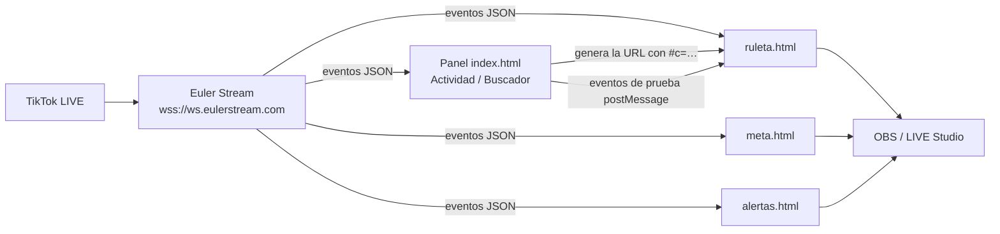

# Panel LIVE para TikTok

Panel y widgets para transmisiones de TikTok LIVE, al estilo de TikFinity: una **ruleta de regalos**,
**metas** con barra de progreso, **alertas** animadas y herramientas para ver la **actividad** del LIVE
y armar un **catálogo con el ID de cada regalo**.

Los widgets se pegan como **URL** en OBS o en TikTok LIVE Studio y funcionan solos: no hay que dejar
ningún programa abierto en el computador.

- Panel publicado: `https://ardiladev.github.io/ruleta-tiktok-live/`
- Repositorio: `https://github.com/ardiladev/ruleta-tiktok-live`

---

## Índice

1. [Dos formas de usarlo](#1-dos-formas-de-usarlo)
2. [Guía rápida](#2-guía-rápida)
3. [Qué hace cada sección del panel](#3-qué-hace-cada-sección-del-panel)
4. [Cómo funciona por dentro](#4-cómo-funciona-por-dentro)
5. [Estructura de archivos](#5-estructura-de-archivos)
6. [Agregar una función nueva](#6-agregar-una-función-nueva)
7. [Modo local (`npm start`)](#7-modo-local-npm-start)
8. [Publicación en GitHub Pages](#8-publicación-en-github-pages)
9. [Límites y cosas que conviene saber](#9-límites-y-cosas-que-conviene-saber)
10. [Seguridad y privacidad](#10-seguridad-y-privacidad)
11. [Cómo probar los cambios](#11-cómo-probar-los-cambios)

---

## 1. Dos formas de usarlo

| | **Por URL (recomendado)** | **Modo local** |
|---|---|---|
| Qué hay que abrir | Nada: solo la URL en OBS / LIVE Studio | `npm start` y dejar la terminal abierta |
| Dónde se configura | `index.html`, publicado en GitHub Pages | `http://localhost:3000/panel` |
| Quién se conecta a TikTok | Cada widget, desde el navegador, vía Euler Stream | `server.js`, con `tiktok-live-connector` |
| Qué incluye | Ruleta, metas, alertas, actividad, buscador de regalos | Solo la ruleta |
| Necesita | API key gratuita de Euler Stream | Node.js 20+ |
| Cambiar la configuración | Copiar la URL nueva y pegarla en la fuente | Se guarda en el panel y la ruleta cambia sola |

---

## 2. Guía rápida

1. Crea una cuenta gratuita en [Euler Stream](https://www.eulerstream.com) y, en el panel de Euler,
   crea una **API key** (sección *API Keys → Create your first key*).
2. Abre el panel y ve a **Ajustes → Cuenta → Conexión**. Escribe tu usuario de TikTok (sin @)
   y pega la API key.
3. Elige un widget, por ejemplo **Superposiciones → Ruletas → Ruleta de regalos**. Ajusta
   premios y regalo y prueba con el botón **Test**.
4. Pulsa **Copy URL** y, en OBS, agrega una **Fuente de navegador** con esa URL
   (en TikTok LIVE Studio: fuente **Enlace**). Tamaños recomendados:
   ruleta 1080 × 1920 · meta 1200 × 400 · alertas 1280 × 720.
5. Listo. Cuando la cuenta esté en vivo, el widget se conecta solo. Si el LIVE todavía no empieza
   o se corta, reintenta cada minuto.

> Si cambias algo en el panel, **la URL cambia**: vuelve a copiarla y pégala en la fuente de OBS.

---

## 3. Qué hace cada sección del panel

El panel se organiza como TikFinity: **categorías** (íconos de la izquierda) → **grupos
desplegables** (menú) → **vistas** (contenido).

| Categoría | Grupo | Vista | Qué hace |
|---|---|---|---|
| Superposiciones | Ruletas | Ruleta de regalos | Gira y sortea un premio cada vez que llega el regalo configurado. Premios con peso (probabilidad), giros por regalo, tope por combo, ocultar en reposo y sonido. |
| | Metas | Likes · Seguidores · Compartidos · Monedas | Barra de progreso con meta, título, color y acción al alcanzarla (duplicar, volver a empezar o dejarla llena). |
| | Alertas | Alertas de eventos | Aviso animado por regalos, seguidores y compartidos, en fila, con sonido y mínimo de monedas. |
| Actividad | En vivo | Eventos en vivo | Conecta el panel al LIVE: contadores (espectadores, likes, seguidores, compartidos, monedas, regalos, mensajes), lista de eventos con filtros y regalos de la sesión. |
| | Regalos | Buscador de regalos | Catálogo permanente con el ID de cada regalo recibido. Nombres propios, búsqueda, “Copiar ID”, “Usar en la ruleta”, agregar a mano, conexión automática y seguimiento de regalos que cambian de código. |
| Ajustes | Cuenta | Conexión con TikTok | Usuario de TikTok y API key de Euler Stream, compartidos por todos los widgets. |

Cada widget tiene una tarjeta con:

- **Copy URL**: copia la URL para OBS (avisa si falta el usuario, la clave o algún dato).
- **Test**: lanza una prueba en la vista previa.
- **Personalizar**: opciones adicionales.
- **Vista previa**: el widget real en modo prueba; **nunca** se conecta al LIVE.

---

## 4. Cómo funciona por dentro

### 4.1 Vista general



- **El panel no es un servidor.** Es una página estática que genera URLs. GitHub Pages solo sirve
  archivos; no ejecuta código.
- **Cada widget se conecta por su cuenta** a Euler Stream con el usuario y la clave que lleva en su URL.
- **El panel también puede conectarse** (sección Actividad) para ver eventos y llenar el catálogo de regalos.
  Esa conexión es independiente de la de los widgets.

### 4.2 La configuración viaja en la URL

Toda la configuración de un widget va en el **fragmento** de la URL (lo que está después de `#`):

```
https://…/ruleta.html?ocultar=1#c=eyJ1IjoiYnlkYWhrbyIsImsiOi…
                      └ opciones visibles └ configuración codificada
```

- `#c=…` es un JSON → UTF-8 → base64 "url-safe" (`codificar` / `decodificar` en `js/comun.js`).
- El navegador **nunca envía el fragmento a ningún servidor**: ni GitHub ni nadie ve la clave al cargar la página.
- Si el `#c=` cambia, el widget se recarga solo.

Claves comunes a todos los widgets: `u` (usuario de TikTok) y `k` (API key).

| Widget | Claves propias en `#c=` | Parámetros visibles (`?…`) |
|---|---|---|
| `ruleta.html` | `g` id del regalo · `r` texto en pantalla · `gpr` giros por regalo · `max` tope por combo · `p` premios `[[texto, peso], …]` | `ocultar=1` · `sonido=0` |
| `meta.html` | `t` tipo (`likes`/`follows`/`shares`/`monedas`) · `o` objetivo · `ti` título · `col` color · `al` al alcanzar (`duplicar`/`reiniciar`/`nada`) · `s` sonido | — |
| `alertas.html` | `ev` eventos `{regalo, follow, share}` · `min` monedas mínimas · `d` segundos · `s` sonido | — |

Parámetros que agrega el panel para la vista previa: `fondo=1` (fondo gris y píldora de estado) y
`prueba=1` (no se conecta a TikTok).

### 4.3 Eventos normalizados

Euler Stream entrega los mensajes de TikTok (`WebcastGiftMessage`, `WebcastLikeMessage`…).
`js/comun.js` los convierte en objetos simples, y **los widgets y el panel solo conocen esta forma**:

```js
{ tipo: 'regalo', usuario, giftId, nombre, cantidad, diamantes, imagen }
{ tipo: 'like', usuario, cantidad, total }
{ tipo: 'follow', usuario }
{ tipo: 'share', usuario }
{ tipo: 'chat', usuario, texto }
{ tipo: 'espectadores', cantidad }
```

Si algún día cambia la fuente de datos, solo hay que tocar `normalizar` y `crearRastreadorRegalos`.

> **TikTok casi nunca manda los detalles del regalo** (`giftDetails`). Por eso, en los regalos,
> `nombre` suele llegar vacío y `diamantes` en 0. **El `giftId` sí llega siempre**, y por eso todo se
> identifica por ID.

### 4.4 Regalos en combo y regalos sueltos

- Un regalo **en combo** (la rosa) llega muchas veces mientras dura la racha (`repeatEnd = 0`) y una
  última vez al terminar (`repeatEnd = 1`), con la cantidad total.
- Un regalo **suelto** (el capibara) llega **una sola vez**, con `repeatEnd = 0`.

Como TikTok casi nunca dice de qué tipo es, `crearRastreadorRegalos` (en `js/comun.js`) hace esto:

1. Cada mensaje de un mismo usuario + regalo + grupo reinicia una espera de **2 segundos**.
2. Si la espera se cumple sin mensajes nuevos, **cuenta lo acumulado** (así un regalo suelto se cuenta a los ~2 s).
3. Si después llega el fin de racha, **solo suma lo que faltaba**: un combo nunca se cuenta doble.

El mismo rastreador lo usan los widgets, el panel y `server.js`.

### 4.5 Conexión y reintentos

`conectarTikTok` (en `js/comun.js`) abre el WebSocket de Euler Stream y decide qué hacer cuando se cierra,
según el código de cierre:

| Código | Significado | Qué hace |
|---|---|---|
| 4401 | Clave inválida | Se detiene y avisa |
| 4400 / 4403 | Usuario inválido / sin permiso | Se detiene y avisa |
| 4404 | La cuenta no está en vivo | Reintenta cada **1 min** |
| 4005 | Terminó el LIVE | Reintenta cada 1 min |
| 4429 | Demasiadas conexiones | Reintenta en 1 min |
| 4555 | Se cumplieron 8 h de conexión | Reconecta en 2 s |
| Otro | Corte inesperado | Reintenta con espera creciente (3 s → 1 min) |

La espera de 1 minuto cuida el límite del plan gratuito (500 solicitudes por hora): cada widget
abierto en OBS y el panel reintentan por separado.

### 4.6 Vista previa y pruebas

La vista previa de cada tarjeta es un `<iframe>` con el widget real en modo `prueba=1`. Los botones de prueba
le mandan **eventos normalizados** por `postMessage`, y el widget los procesa igual que uno real. El widget
responde con su estado (por ejemplo, “Modo prueba”), que el panel muestra junto al punto verde o naranja.
Los mensajes solo se aceptan si vienen del mismo origen.

### 4.7 El panel por dentro

| Archivo | Responsabilidad |
|---|---|
| `js/panel/app.js` | Arranque, riel, menú desplegable, navegación por `#/id-de-vista`, barra superior, conexión automática |
| `js/panel/registro.js` | **Mapa del panel**: categorías → grupos → vistas. Agregar una función empieza aquí |
| `js/panel/almacen.js` | Lo que el panel guarda en el navegador (`localStorage`, clave `panel-live`) |
| `js/panel/envivo.js` | Conexión del panel al LIVE: contadores, lista de eventos, regalos de la sesión |
| `js/panel/ui.js` | Componentes: `el()`, `icono()`, `tarjeta`, `campo`, `casilla`, `nota`, `tarjetaWidget` |
| `js/panel/vistas/*.js` | Una vista por archivo |

**Ciclo de vida de una vista.** Una vista es `{ id, titulo, descripcion, render({ senal }) }`. Al entrar,
`app.js` llama `render`, que devuelve los nodos de la vista. Al salir, cancela `senal` (un `AbortSignal`):
todas las suscripciones (`almacen.alCambiar(fn, senal)`, `envivo.alCambiar(fn, senal)`) y los oyentes
(`addEventListener(…, { signal: senal })`) se sueltan en ese momento.

**Interfaz sin `innerHTML`.** Todo se construye con `el()`, que inserta el texto como texto. Por eso es
seguro mostrar nombres y mensajes del chat que vienen de TikTok.

### 4.8 Catálogo de regalos y cambios de código

- Cada regalo que llega mientras el panel está conectado se anota en `almacen.regalos`: ID, nombre de TikTok,
  nombre propio, precio, veces, primera y última vez.
- La lista se guarda en el navegador y **continúa en cada LIVE**. Con **Conectar automáticamente**, el panel
  se conecta solo al abrirse.
- **Si un regalo cambia de código:**
  - si TikTok manda el mismo **nombre y precio** que un regalo guardado, el código se reescribe solo;
  - si coincide el nombre pero el precio es desconocido o distinto, el panel **pregunta**. Hay regalos distintos
    con el mismo nombre (por ejemplo, dos “Candy Bouquet” de 249 y 349 monedas);
  - si la persona le pone a un código nuevo un nombre que ya existe, el panel ofrece unirlos;
  - al unir, se suman las veces, se guarda el código anterior (`antes: …`) y, si la ruleta usaba el código
    viejo, se actualiza y aparece un aviso para volver a copiar su URL.

---

## 5. Estructura de archivos

```
ruleta-tiktok-live/
├── public/                         ← lo que publica GitHub Pages
│   ├── index.html                  panel principal (esqueleto; lo arma js/panel/app.js)
│   ├── ruleta.html                 widget ruleta     ┐
│   ├── meta.html                   widget meta       ├ solo estructura HTML
│   ├── alertas.html                widget alertas    ┘
│   ├── panel.html                  panel del modo local (npm start)
│   ├── css/
│   │   ├── panel.css               estilos del panel
│   │   ├── panel-local.css         estilos del panel del modo local
│   │   ├── widget.css              base común de los widgets (transparencia, píldora de estado)
│   │   └── widgets/
│   │       ├── ruleta.css
│   │       ├── meta.css
│   │       └── alertas.css
│   └── js/
│       ├── comun.js                URL ↔ config, eventos normalizados, rastreador de regalos,
│       │                           conexión con Euler Stream, arranque de widgets, sonido
│       ├── panel-local.js          lógica del panel del modo local
│       ├── widgets/
│       │   ├── ruleta.js           dibujo, giro, cola; modo directo y modo servidor
│       │   ├── meta.js
│       │   └── alertas.js
│       └── panel/
│           ├── app.js
│           ├── registro.js
│           ├── almacen.js
│           ├── envivo.js
│           ├── ui.js
│           └── vistas/
│               ├── ruleta.js
│               ├── metas.js
│               ├── alertas.js
│               ├── actividad.js
│               ├── regalos.js
│               └── conexion.js
├── server.js                       modo local: tiktok-live-connector + socket.io
├── config.example.json             plantilla de config.json (modo local)
├── package.json
└── .github/workflows/pages.yml     publica public/ en GitHub Pages
```

Cada archivo empieza con un encabezado que explica qué hace y lista sus secciones. Cada sección está
marcada con un separador (`// ---- 1. … ----` en JS y `/* ---- 1. … ---- */` en CSS).

---

## 6. Agregar una función nueva

Ejemplo: un widget **“Último seguidor”**.

1. **El widget** (si va en OBS):
   - `public/ultimo.html`: copia `alertas.html` y cambia el HTML y las rutas de CSS/JS.
   - `public/css/widgets/ultimo.css`: sus estilos.
   - `public/js/widgets/ultimo.js`: su lógica. La pieza clave es `iniciarWidget`:
     ```js
     import { leerConfig, iniciarWidget } from '../comun.js';
     const cfg = leerConfig() || {};
     iniciarWidget({
       cfg,
       alEvento(evento) {
         if (evento.tipo === 'follow') document.getElementById('nombre').textContent = evento.usuario;
       },
     });
     ```
     `alEvento` recibe los eventos reales del LIVE **y** los de prueba del panel.
2. **La vista del panel**: `public/js/panel/vistas/ultimo.js`. Copia `vistas/alertas.js`;
   `tarjetaWidget({ titulo, archivo: 'ultimo.html', config, pruebas, senal })` te da la URL, los botones y
   la vista previa.
3. **El menú**: impórtala en `public/js/panel/registro.js` y agrégala a un grupo, o crea un grupo o una
   categoría nueva. El menú y la navegación se arman solos.

---

## 7. Modo local (`npm start`)

Es la versión original: un servidor en el computador que se conecta al LIVE y controla la ruleta.
Solo incluye la ruleta.

```bash
npm install
npm start
```

- Panel: `http://localhost:3000/panel`
- Ruleta para OBS: `http://localhost:3000/ruleta` (1080 × 1920). Admite `?ocultar=1` y `?sonido=0`.

`config.json` se crea solo a partir de `config.example.json` y **no se sube al repositorio**:

| Campo | Para qué sirve |
|---|---|
| `usuario` | Último usuario conectado |
| `regalo.giftId` | **El que manda**: ID del regalo que activa la ruleta (la rosa es 5655) |
| `regalo.nombres` | Respaldo por nombre (TikTok casi nunca manda el nombre) |
| `girosPorRegalo` | Giros por cada regalo |
| `maxGirosPorEvento` | Tope de giros por combo |
| `premios` | `[{ texto, peso }]`; también se editan desde el panel |
| `timeoutMs` | Espera por petición HTTP (la librería trae 10 s, poco para el primer intento) |
| `signApiKey` | Opcional: API key de Euler Stream para el servidor de firmas |
| `puerto` | Puerto del servidor (3000 por defecto; también `PORT=…`) |

La terminal deja un rastro de cada regalo (`[regalo] … · id XXXX · …`), útil para averiguar IDs.

---

## 8. Publicación en GitHub Pages

- Cada `git push` a `main` ejecuta `.github/workflows/pages.yml`, que publica **solo la carpeta `public/`**.
  `server.js`, `config.json` y `node_modules` nunca se publican.
- En el repositorio: **Settings → Pages → Source: GitHub Actions** (ya configurado).
- La publicación tarda uno o dos minutos. GitHub puede servir la versión anterior hasta unos 10 minutos
  por caché: en OBS, usa **“Actualizar la caché de la página actual”** en las propiedades de la fuente.

---

## 9. Límites y cosas que conviene saber

- **No es una API oficial de TikTok.** Euler Stream y `tiktok-live-connector` leen el servicio interno de
  TikTok. Funciona, pero puede fallar cuando TikTok cambia algo.
- **Plan gratuito de Euler Stream:** 60 solicitudes por minuto, 500 por hora y 2500 por día, y conexiones
  limitadas. Cada widget en OBS y el panel conectado gastan conexiones por separado.
- **Nombre y precio de los regalos casi nunca llegan.** Consecuencias: la meta de **monedas** solo suma los
  regalos que traen precio; las **alertas** muestran “un regalo” si no llega el nombre (y no aplican el mínimo
  de monedas a los regalos sin precio); en el buscador, el nombre lo pones tú.
- **El catálogo de regalos vive en un solo navegador** y solo anota mientras el panel está abierto y conectado.
  Puedes poner el panel en OBS como **dock de navegador** para que esté abierto siempre que transmites.
  Ese dock tendrá su propia lista, separada de la de Chrome.
- **Las metas empiezan en 0** cada vez que se abre o recarga la fuente en OBS.
- **No hay una lista oficial de IDs de regalos.** Usa el Buscador de regalos (lo más fiable, porque son los
  regalos que llegan a tu cuenta) o el navegador de regalos de TikFinity.
- **Premios:** que sean cosas que se puedan cumplir en el LIVE y que respeten las normas comunitarias de TikTok.

---

## 10. Seguridad y privacidad

- La **API key va dentro de las URLs** de los widgets (en el fragmento `#`, que no se envía a ningún servidor).
  Cualquiera que vea la URL completa puede usar tu clave: **no la muestres en pantalla ni la compartas**.
  Si se filtra, bórrala en el panel de Euler Stream y crea otra.
- El panel guarda usuario, clave, configuración y catálogo **solo en tu navegador** (`localStorage`).
- `config.json` (modo local) está en `.gitignore`.
- Los datos que vienen de TikTok (nombres, chat) se muestran siempre como texto, nunca como HTML.
- La comunicación panel ↔ vista previa usa `postMessage` restringido al mismo origen.

---

## 11. Cómo probar los cambios

1. **Sin conexión:** sirve `public/` con cualquier servidor estático (o `npm start` y abre
   `http://localhost:3000/index.html`) y usa los botones de prueba de cada tarjeta.
2. **Eventos simulados en Actividad:** en la consola del navegador:
   ```js
   const envivo = await import('./js/panel/envivo.js');
   envivo.simular({ tipo: 'regalo', usuario: 'Ana', giftId: '5655', nombre: '', cantidad: 3, diamantes: 0, imagen: '' });
   ```
3. **Con el LIVE real:** Actividad → Eventos en vivo → **Conectar al LIVE**, y pide que te envíen regalos,
   likes y follows.
4. **Modo local:** `npm start`, abre `/panel` y usa “Enviar 1 rosa”.
